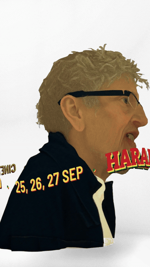
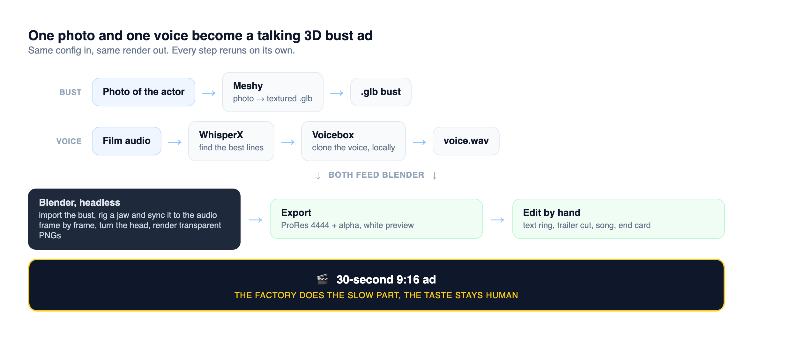

<div align="center">

# 🎭 Harakiri Ad Factory

### A local pipeline that turns one photo and one voice into a talking 3D bust ad for a film with no marketing budget.

[](#the-pipeline)
[-E87D0D?logo=blender&logoColor=white&style=flat-square)](#the-pipeline)
[](#the-pipeline)
[](#the-pipeline)
[](#the-pipeline)
[](#the-pipeline)

<br>



<sub>One of the finished ads: the 3D bust of a character turns and speaks in the actor's own voice.</sub>

</div>

---

A small, local pipeline I built to make the vertical ads for *Harakiri, Me Haces Falta*, the film I co-wrote and star in. Each ad is 30 seconds: a 3D bust of one of the characters floats on a white background, turns, and speaks in the actor's own voice. Then the trailer cuts in, built around that character's face, and the ad closes on the ticket call to action.

We had no marketing budget, so I treated the ads like a production line. One config per ad, the same inputs always give the same render, and every step can be redone on its own without breaking the rest.

## The pipeline



1. **Bust.** A photo of the actor goes into Meshy, which gives back a textured `.glb`.
2. **Voice.** I transcribed the whole film with WhisperX, searched the transcript for each character's best lines, and cut clean references with FFmpeg. Voicebox clones the voice locally, so new lines sound like the actor without anyone going back to a studio.
3. **Animation (`blender/cabeza.py`).** Blender runs headless. The script imports the bust, decimates it, cuts it at the mouth, and weights a jaw that hinges open and closed. The jaw follows the audio's RMS envelope frame by frame. Optionally it uses a Rhubarb viseme curve, because RMS knows how loud something is but not what is being said. Then it turns the head and renders transparent PNGs with Eevee. Everything can be tuned with environment variables. For example, the jaw's maximum opening is 0.15 rad, picked by comparing three values on the same audio.
4. **Export (`blender/girar.py`).** This wraps the whole render into one command. Each job gets its own folder with the converted audio, the frames, a ProRes 4444 `.mov` with alpha for the editor, a white-background `.mp4` to review, and a log.
5. **Edit.** The bust, the spinning text ring, a trailer cut built around that character, the character's own song and a fixed end card all go together into a 9:16 ad.

```bash
python3 blender/girar.py taxista --audio voz.m4a --modelo busto.glb
python3 blender/girar.py prueba --audio voz.wav --calibrar   # front and profile, mouth open and closed
```

## What I learned

The automated assembly at the end looked too mechanical, so I went back to editing the final cut by hand, one ad at a time. The factory does the slow, repetitive part, and the taste stays human.

## Stack

Python · Blender (bpy, headless) · Meshy · WhisperX · Voicebox · FFmpeg · Rhubarb Lip Sync

The code comments are in Spanish.

---

<div align="center">
<sub>Built by <a href="https://github.com/diego-salomon">Diego Salomón</a>. · <a href="https://www.linkedin.com/in/diegosalomon">LinkedIn</a></sub>
</div>
